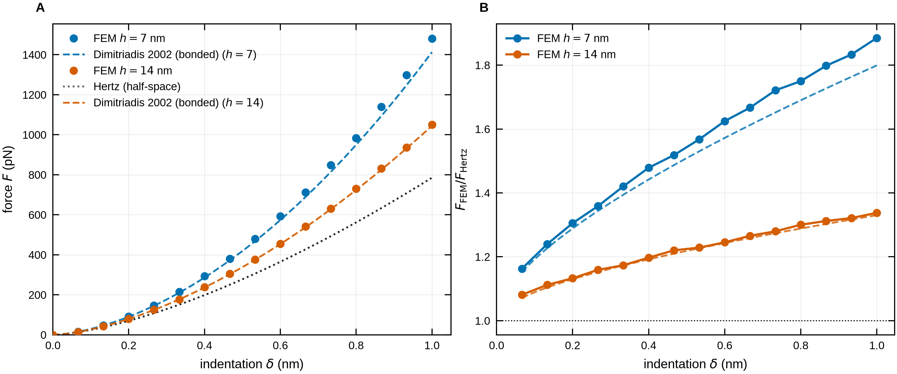
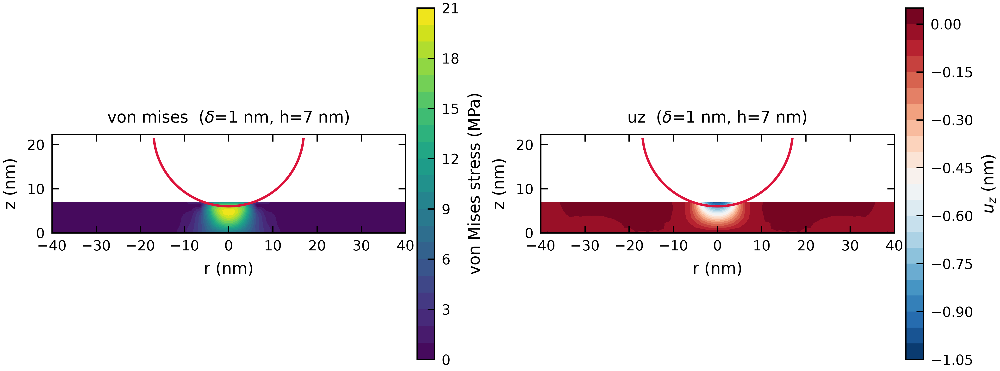
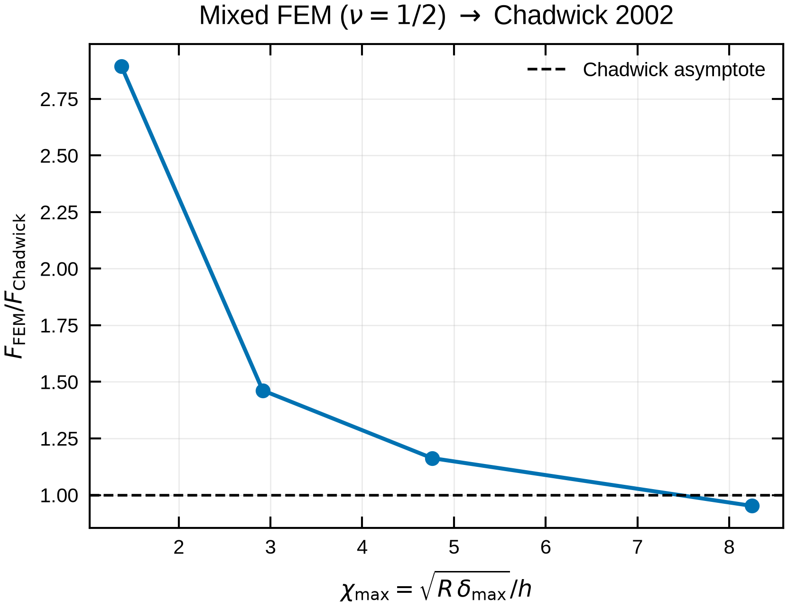
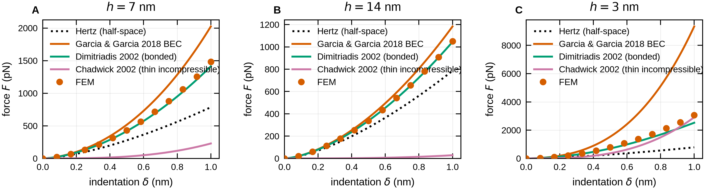

# nanoindent

[](https://github.com/LorenaRedondo/nanoindent/actions/workflows/ci.yml)
[](LICENSE)
[](pyproject.toml)
[](#project-status)
[](https://docs.astral.sh/uv/)

**Website:** <https://lorenaredondo.github.io/nanoindent/>

FEM simulation of **AFM nanoindentation of thin elastic films** by a rigid
spherical tip — an open-source Python alternative to the commercial-FEM
(COMSOL-style) workflow for this problem. The reference setup: a rigid sphere
(R = 17 nm) indenting a linear-elastic film (E = 130 MPa, thickness
h = 7 / 14 nm, lateral size 100 nm) bonded to a rigid substrate, frictionless
contact, indentation up to 1 nm.

The library computes force–indentation curves **F(δ)**, quantifies the
**bottom-effect stiffening** of a finite-thickness bonded film relative to the
Hertz half-space, and ships analytic benchmarks (Hertz, Dimitriadis 2002,
Garcia & Garcia 2018) for validation.

Validation here is against **analytic closed forms**, not against another
solver: a second FEM code carries its own discretisation error and its own
unstated mesh choices, so agreeing with it would show that two codes made
similar decisions — not that either is right. That claim has been tested once,
against MoFEM's axisymmetric Hertz benchmark, and it held: MoFEM's result lands
inside this solver's own mesh scatter, separating nothing that Hertz had not
already settled (`examples/mofem_cross_check.py`, `docs/design.md` §6.3). See
[`docs/design.md`](docs/design.md) for the modelling and numerical rationale,
and the judgement calls (ν, domain size, small strain) stated as such.

---

## Highlights

- 2D **axisymmetric** small-strain linear elasticity, vector **P2** elements.
- **Exact spherical gap** function (not the parabolic approximation).
- **Penalty contact** with an active-set Newton solver, displacement-controlled
  load stepping.
- Two independent **reaction-force measures** (contact-pressure integral and
  bonded-bottom σ_zz integral) cross-checked for equilibrium.
- **Analytic benchmarks** and built-in **convergence studies** (mesh, penalty,
  load step).
- **Force-volume maps** over heterogeneous samples and **viscoelastic** dynamic
  moduli `E'(ω)`, `E''(ω)` — both from a *single* FEM solve, since force is
  exactly proportional to modulus (`docs/design.md` §8).
- Clean, parametrized, fully-tested modules — no magic numbers in solver code.

## Bottom-effect result

For E = 130 MPa, ν = 0.3, R = 17 nm, a bonded film is markedly stiffer than the
Hertz half-space, and thinner films are stiffer still. At δ = 1 nm the FEM
gives F/F_Hertz ≈ **1.88** for h = 7 nm and ≈ **1.34** for h = 14 nm, in close
agreement with the bonded Dimitriadis 2002 correction:



*Biophysical Journal-style figure from `examples/publication_figure.py`:
(A) F(δ) for h = 7 / 14 nm — FEM (markers) vs. Hertz (dotted) and the bonded
Dimitriadis 2002 correction (dashed); (B) the stiffening ratio F/F_Hertz.*

---

## Installation

nanoindent requires **Python 3.11+**. The default backend is
[scikit-fem](https://scikit-fem.readthedocs.io/), which installs from PyPI with
no compiler or conda needed.

### With uv (recommended)

```bash
git clone https://github.com/LorenaRedondo/nanoindent.git
cd nanoindent
uv sync                       # creates .venv, installs the package + dev tools from uv.lock
uv run python examples/paper_reproduction.py
```

To use it as a dependency of your own project:

```bash
uv add "nanoindent @ git+https://github.com/LorenaRedondo/nanoindent"
```

### With pip

```bash
pip install "git+https://github.com/LorenaRedondo/nanoindent"
```

### Optional extras

| extra | adds | for |
|---|---|---|
| `viz` | pyvista, imageio-ffmpeg | 3D fields and MP4 animations |
| `video` | Pillow, imageio-ffmpeg | HS-AFM movie readers and MP4 export |
| `afm` | igor2 | Asylum `.ibw` files |
| `report` | pandas | rich tables in `nanoindent.report` |
| `docs` | python-docx, python-pptx, Pillow | `.docx` / `.pptx` export examples |
| `tracking` | mlflow | experiment tracking export |
| `web` | streamlit | interactive dashboard |

```bash
uv sync --extra web --extra viz        # with uv
pip install "nanoindent[web,viz]"      # with pip
```

### Alternative backend: FEniCSx / dolfinx

The design also targets **dolfinx** with the **gmsh** mesher, best installed
through conda-forge (do not attempt a pip-only install):

```bash
conda install -c conda-forge fenics-dolfinx mpich pyvista gmsh python-gmsh
```

Only `solver.py` is backend-specific (weak-form assembly); `config`, `contact`,
`geometry`, `analytics` and `postproc` are backend-agnostic.

---

## Quick start

```python
from nanoindent import SimulationConfig, IndentationSolver

cfg = SimulationConfig(
    R=17.0,            # nm, tip radius
    E=130.0,           # MPa, sample Young's modulus
    nu=0.3,            # Poisson's ratio — a default, not a determined value; sweep it
    h=7.0,             # nm, film thickness
    L=100.0,           # nm, lateral size (radius)
    delta_max=1.0,     # nm
    n_steps=20,
    mesh_size_contact=0.15,  # nm, near the tip
    mesh_size_edge=6.0,      # nm, at the far edge (see "Meshing" below)
    penalty_alpha=400.0,
)
result = IndentationSolver(cfg).run()          # -> ForceCurve
result.save("h7.csv")
result.plot(compare=["hertz", "dimitriadis_bonded", "garcia_bec"])
```

Reproduce both paper thicknesses with one command:

```bash
uv run python examples/paper_reproduction.py   # writes results/{h7,h14}.csv + PNGs
python examples/hertz_validation.py             # thick-film Hertz check
python examples/mofem_cross_check.py            # MoFEM's axisymmetric benchmark; mesh-scatter floor
python examples/synthetic_analysis.py           # realistic dataset -> modulus recovery
python examples/publication_figure.py           # journal-ready multi-panel figure (PDF/PNG/SVG)
python examples/model_comparison.py              # Hertz/Garcia/Dimitriadis/Chadwick vs FEM
python examples/chadwick_verification.py         # incompressible (nu=0.5) mixed FEM -> Chadwick
python examples/field_heatmap.py                 # von Mises / displacement field heatmaps
python examples/force_volume.py                  # synthetic force map over a two-phase sample; round-trip
python examples/viscoelastic_sweep.py            # dynamic moduli E'(w)/E''(w) vs closed-form SLS
python examples/afm_force_curves.py              # AFM view: rate-dependent apparent modulus + hysteresis
python examples/viscoelastic_fit.py              # inverse: recover E0/E_inf/tau from relaxation + sweep data
python examples/force_volume_video.py            # video: tip inserting pixel-by-pixel, map filling in
python examples/fem_insertions_video.py          # video: real FEM von Mises field, several insertions
python examples/afm_recovery_video.py            # video: viscoelastic recovery limits between lateral pokes
python examples/afm_recovery_compare.py          # video: viscoelastic vs more-elastic recovery, side by side
```

### Force volume and viscoelasticity

Force is exactly proportional to modulus (`F = E·φ(δ)`, verified to 0.0000% over a
400× range), so one FEM solve builds the geometric kernel `φ` and everything else
is analytic scaling of it:

```python
import numpy as np
from nanoindent import SimulationConfig, forcemap as fm, viscoelastic as ve

cfg  = SimulationConfig(R=20, nu=0.5, h=6, formulation="mixed", delta_max=1.5)
spec = fm.ForceVolumeSpec(64, 64, pitch_nm=8, ramp_freq_hz=2, z_amplitude_nm=1.2)
E    = fm.two_phase_field(64, 64, E_soft=2.0, E_stiff=20.0)   # stiff domains in soft matrix
vol  = fm.simulate_force_volume(spec, E, cfg)                 # 4096 curves, ONE solve
E_map = vol.recover_modulus_map(model="kernel")              # round-trip: recover the input

# frequency-dependent (viscoelastic) modulus via the correspondence principle
sls  = ve.standard_linear_solid(E0=30, E_inf=10, tau=1e-3)   # MPa, MPa, s
spectrum = ve.frequency_sweep(sls, vol.kernel.phi_of,
                              lambda d0: ve.kernel_slope(vol.kernel.phi_of, d0),
                              omegas=2*3.14159*np.logspace(0, 4, 20),
                              delta0=1.0, delta_amp=0.05)
spectrum.max_rel_error()   # recovered E'(w),E''(w) vs closed form: ~1e-3
```

Two videos animate this (click to view):

- [**Force-map acquisition**](docs/force_volume_video.mp4) — the tip inserting
  pixel by pixel, the force curve reflecting local stiffness, the modulus map
  filling in.
- [**Real FEM field, several insertions**](docs/fem_insertions_video.mp4) — the
  actual von Mises stress field on the cross-section as the tip indents soft and
  stiff regions in turn.
- [**Recovery between pokes**](docs/afm_recovery_video.mp4) — on one viscoelastic
  material, the tip doing down-up cycles and stepping laterally; the surface
  profile shows residual dents that haven't sprung back before the next poke, with
  a limit map of where (lateral pitch × scan frequency) recovery fails.
- [**Viscoelastic vs elastic**](docs/afm_recovery_compare.mp4) — the same scan on
  a viscoelastic material (persistent trough) and a more elastic one (recovers
  cleanly, fresh material at every poke), set by the viscous fraction β = 1 −
  E_inf/E0.
- **Intermediate materials** — the same scan swept across the elastic↔viscoelastic
  axis (regenerate any point with `--viscous-fraction` / `--tau`):
  [mostly elastic](docs/recovery_mid1_mostly_elastic.mp4) (β=0.35, τ=25 ms, ~5%
  residual), [balanced](docs/recovery_mid2_balanced.mp4) (β=0.55, τ=80 ms, ~16%),
  [mostly viscoelastic](docs/recovery_mid3_mostly_viscoelastic.mp4) (β=0.70,
  τ=200 ms, ~22%).

### Publication-quality figures

`nanoindent.plotting` produces journal-ready figures: **vector output**
(PDF / SVG / EPS) plus high-dpi PNG, a **colour-blind-safe** Okabe-Ito palette,
embedded (editable) fonts, and minimal chartjunk. **Journal presets** set the
right font, panel-label convention, and physical column widths — the default is
**Biophysical Journal** (Cell Press: Arial, 7 pt, uppercase bold panel letters,
85 / 114 / 174 mm columns; Arial falls back to metric-identical Liberation Sans
on systems without it).

```python
from nanoindent import plotting
plotting.set_publication_style(journal="biophysical_journal")   # or "generic"
w = plotting.journal_widths("biophysical_journal")["double"]    # 174 mm in inches
fig = plotting.plot_force_curves({7.0: c7, 14.0: c14},
                                 compare=["hertz", "dimitriadis_bonded"])
plotting.panel_label(fig.axes[0], 0)             # "A" (Cell Press) / "(a)" generic
plotting.save_figure(fig, "figures/fig2", formats=("pdf", "png", "svg"))
```

Add a journal by dropping an entry in `plotting.JOURNAL_PRESETS`.

Available plotters: `plot_force_curves`, `plot_stiffening_ratio`,
`plot_modulus_recovery`, `plot_model_comparison`, `plot_convergence`,
`plot_field` (field heatmaps), plus `save_figure` (multi-format) and the
`SINGLE_COLUMN` / `DOUBLE_COLUMN` width constants.

### Field heatmaps

`plot_field` renders any recovered field over the axisymmetric (r, z)
cross-section — von Mises stress, `sigma_zz`, mechanical `pressure`,
displacement magnitude, `uz`, `ur` — mirrored across the axis with the rigid
tip outline overlaid. Fields are L2-projected to the mesh vertices via
`solver.nodal_field(name)`.

```python
solver = IndentationSolver(cfg); solver.run()
plotting.plot_field(solver, field="von_mises")            # heatmap
plotting.plot_field(solver, field="uz", cmap="RdBu_r", deformed=True)
vm = solver.nodal_field("von_mises")                      # raw nodal values
```



*`examples/field_heatmap.py`: von Mises stress concentrates under the tip
(~21 MPa at h=7 nm, δ=1 nm) while u_z reaches −δ at the apex and 0 at the
bonded substrate.*

**Animations.** Run the solver with `run(store_history=True)` and
`plotting.animate_field` renders the field evolving over the load steps to a
video (MP4 when an ffmpeg writer is available — `pip install imageio-ffmpeg` —
otherwise an animated GIF):

```python
solver = IndentationSolver(cfg); solver.run(store_history=True)
plotting.animate_field(solver, field="von_mises", path="indent.mp4", fps=12)
```

`examples/von_mises_video.py` produces the von Mises indentation movie for the
MSNL-BIO-DC case with one command.

---

## Indenter geometry

The indenter shape is a configuration parameter. Because the model is **2D
axisymmetric**, the tip must be a surface of revolution — four exact shapes are
built in:

| `tip_shape` | parameters | analytic benchmark |
|---|---|---|
| `"sphere"` (default) | `R` | Hertz |
| `"paraboloid"` | `R` | Hertz (parabolic tip) |
| `"cone"` | `tip_half_angle_deg` **or** `tip_pyramid` | Sneddon `F=(2/π)E*tanθ·δ²` |
| `"blunted_cone"` | `R`, `tip_half_angle_deg`/`tip_pyramid` | sphere→cone crossover |

```python
SimulationConfig(tip_shape="cone", tip_half_angle_deg=70.3)
SimulationConfig(tip_shape="blunted_cone", R=17.0, tip_half_angle_deg=35.0)
```

**Pyramids** (Berkovich, Vickers, cube-corner) are *not* axisymmetric and
cannot be meshed directly in this model. The standard workaround — an
**equivalent cone** with a half-angle reproducing the same projected-area-vs-
depth law — is built in:

```python
SimulationConfig(tip_shape="cone", tip_pyramid="berkovich")   # 70.3° equiv. cone
```

Each shape is validated against its analytic law in the thick-film limit
(sphere/paraboloid → Hertz, cone → Sneddon, all within a few percent). A sharp
cone reproduces its δ² force law; the blunted cone reduces to the sphere while
contact stays on the spherical cap and stiffens toward the cone beyond it.

## Web dashboard

An interactive Streamlit app drives the whole library from a browser — set the
tip, sample, substrate, and mesh from the sidebar and get the force–indentation
curve (with analytic overlays), the von Mises / displacement / pressure field
heatmap, solution diagnostics, and a modulus fit, all from the real solver:

```bash
uv sync --extra web
streamlit run dashboard/app.py
```

Incompressible samples (ν ≥ 0.45) automatically switch to the locking-free
mixed formulation; results and the F(δ) CSV are downloadable. To share it,
deploy `dashboard/app.py` to Streamlit Community Cloud (or any host that can run
a Python process).

## Units

A single consistent system is used everywhere:

| Quantity          | Unit |
|-------------------|------|
| length            | nm   |
| modulus / stress  | MPa  |
| force             | pN   |

The force unit follows from the other two, since
`1 MPa·nm² = 1e6 Pa · (1e-9 m)² = 1e-12 N = 1 pN`. Any force obtained by
integrating a stress over an area therefore comes out directly in **pN**, a
natural AFM scale (the Hertz estimate at δ = 1 nm is ≈ 786 pN).

---

## Physics & numerics

- **Boundary conditions**: bottom `z = 0` — `substrate="bonded"` fixes it
  (`u_r = u_z = 0`), `substrate="unbonded"` lets the film slide frictionlessly
  on the rigid substrate (`u_z = 0`, `u_r` free); axis `r = 0` symmetry
  (`u_r = 0`); lateral edge `r = L` traction-free; top `z = h` frictionless
  unilateral contact against the rigid tip. A bonded incompressible film is far
  stiffer than an unbonded one (see `examples/msnl_bio_dc.py --substrate`).
- **Gap function**: `g(r) = (z_c − √(R²−r²)) − (h + u_z)`, sphere centre
  `z_c = h + R − δ`, penetration `[−g]₊`. Contact is impossible for `r ≥ R`.
- **Penalty**: local stiffness `k_pen = α · E / h_local` with `h_local` the
  local facet size, so the penalty stays consistent under refinement. The
  contact residual `∫ k_pen [−g]₊ v_z · 2πr dr` is added to the elastic
  residual; the only nonlinearity is the contact active set, handled by a
  Newton iteration per load step.
- **Reaction force**: measured two ways — integrating the contact pressure over
  the top surface, and integrating σ_zz over the bonded bottom — and the
  relative mismatch is reported as a solution-quality metric (warns above a
  configurable tolerance, ~1% on a converged mesh).

### Meshing

The mesh is a graded axisymmetric rectangle, clustered at the contact point
`(r = 0, z = h)` (element size `mesh_size_contact`) and coarsening toward the
lateral edge (`mesh_size_edge`). A **0.1 nm edge size** on a 100 nm domain is
unreasonably fine (a huge element count for negligible benefit far from
contact); the default here is a saner few-nm edge size, with the convergence
study as the arbiter. Vertical grading guarantees several
element layers across even a 7 nm film, and quadratic (P2) displacement
elements resolve bending and contact accurately with few elements.

### Near-incompressibility and the mixed formulation

For `ν ≥ 0.45` the single-field ("primal") P2 displacement formulation locks
and over-stiffens. Set `formulation="mixed"` for a **Taylor–Hood** (P2
displacement / P1 pressure) two-field formulation that is locking-free and
supports fully incompressible **`ν = 0.5`** exactly:

```python
SimulationConfig(nu=0.5, formulation="mixed", tip_shape="paraboloid", ...)
```

The mixed solve assembles the block system

```
[ A + K_contact   Bᵀ ] [u]   [f_contact]
[ B              −C   ] [p] = [   0     ]
```

with `A(u,v)=∫2μ ε:ε r`, `B(u,q)=∫(∇·u) q r`, `C(p,q)=∫(1/λ) p q r` (→ 0 at
`ν=½`), Newton-iterated over the contact active set. It reproduces the primal
result at `ν=0.3` (agreement < 0.5%).

**Verifying Chadwick.** Because it handles `ν = ½`, the mixed formulation lets
us check the Chadwick 2002 thin-incompressible-layer law directly. Sweeping the
thin-film parameter `χ = √(Rδ)/h`, the incompressible FEM force converges to
`F=(2π/3)E R²δ³/h³` as `χ` grows — recovering both the scaling and the
coefficient (`examples/chadwick_verification.py`):



| χ_max | 1.4 | 2.9 | 4.8 | 8.3 |
|---|---|---|---|---|
| F_FEM / F_Chadwick | 2.90 | 1.46 | 1.16 | 0.95 |

---

## Convergence & validation

`nanoindent.convergence` provides three studies ([`docs/design.md` §6.1](docs/design.md)):

```python
from nanoindent import SimulationConfig, convergence
cfg = SimulationConfig(h=14.0)
convergence.mesh_study(cfg)        # refine mesh_size_contact; F converges < 0.5%
convergence.penalty_study(cfg)     # alpha sweep; F plateaus, interpenetration -> 0
convergence.load_step_study(cfg)   # n_steps sweep; elastic => path-independent
```

### Comparing contact models

`nanoindent.analytics` bundles the standard AFM contact models and lets you
compare them (and the FEM) on one grid. The default set is **Hertz**,
**Garcia & Garcia 2018**, **Dimitriadis 2002 (bonded)**, and **Chadwick 2002**:

```python
from nanoindent import SimulationConfig, analytics, plotting
cfg = SimulationConfig(h=7.0)
table = analytics.compare_models(cfg)                 # dict: delta + each model
plotting.plot_model_comparison(cfg, fem_curve=result) # overlay all + FEM
```

| key | model | regime |
|---|---|---|
| `hertz` | Hertz half-space | thick film / baseline |
| `garcia_bec` | Garcia & Garcia 2018 BEC (paraboloid) | bonded, finite h |
| `dimitriadis_bonded` | Dimitriadis 2002 bonded polynomial (general ν) | bonded, crossover |
| `chadwick_2002` | Chadwick 2002 thin **incompressible** layer, `F=(2π/3)E R²δ³/h³` | bonded, deep thin-film (ν→½) |



`analytics.BEC_MODELS` is the default list; pass your own `models=[...]` to
either function. Note the two 2002 papers are **distinct**: Dimitriadis *et al.*
(*Biophys. J.* **82**, 2798) is the empirical polynomial that interpolates
Hertz→thin for general ν; Chadwick (*SIAM J. Appl. Math.* **62**, 1520) is the
asymptotic thin-**incompressible**-layer law it is built on — it stiffens as
`1/h³` and only applies in the deep thin-film limit (it does *not* reduce to
Hertz for thick films). `examples/model_comparison.py` overlays all four vs. the
FEM across thicknesses.

### Ingesting real AFM experiments

`nanoindent.experiment` reads **raw instrument force curves**, calibrates them
to force-indentation, and fits the modulus. An AFM records cantilever
**deflection** vs. **piezo-Z**, so you supply the spring constant `k` (N/m) and,
if the deflection is in volts, the sensitivity InvOLS (nm/V); the module handles
baseline subtraction, contact-point detection, and the cantilever-compliance
correction `δ = (Z−Z₀) − (d−d₀)`.

Supported formats (dispatched by extension via `load_afm`):

| format | extension | reader |
|---|---|---|
| JPK | `.jpk-force`, `.jpk` | `read_jpk` (ZIP: segment headers + channel data) |
| Bruker / Veeco Nanoscope | `.spm`, `.pfc` | `read_bruker` (ASCII header + int16 data) |
| Asylum Research | `.ibw` | `read_ibw` (Igor wave; needs `pip install igor2`) |
| generic | `.csv`, `.txt`, `.tsv` | `read_csv` (Z, deflection columns) |

```python
from nanoindent import load_afm, analyze_experiment
curve = load_afm("cell_force.jpk-force")          # or .spm / .ibw / .csv
fit, (delta, force) = analyze_experiment(
    curve, R=17.0, nu=0.5, h=7.0, model="dimitriadis_bonded")
print(fit.E_fit)                                   # recovered modulus (MPa)
```

### Force maps & supported lipid bilayers

`read_jpk_map` reads a **JPK force-volume map** (`.jpk-force-map`) — a grid of
force curves — decoding the real JPK `lcd-info` calibration chain (raw →
volts → distance/force) and returning a `JPKForceMap` of `ForceCurveData` with
the spring constant and InvOLS auto-extracted. `nanoindent.slb` then analyses a
supported-lipid-bilayer map:

```python
from nanoindent import read_jpk_map, slb
fmap = read_jpk_map("bilayer_map.jpk-force-map")
an = slb.analyze_map(fmap, R=20.0, nu=0.5, film_thickness=5.0, fit_max_delta=3.0)
print(an.summary())                 # breakthrough force, height, E per model
fig = slb.plot_analysis(an)         # 4-panel: distributions + FEM cross-check
```

Per curve it extracts the **breakthrough (yield) force**, **two bilayer-height
measures** — (A) contact-point→substrate from the measured-height (capacitive)
channel, ≈ the true bilayer thickness, and (B) the breakthrough penetration
step — the **area compressibility modulus κ_A** (Das/Connell 2010,
`F = π κ_A R z₀²/(2d−z₀)²`, the modulus for a *fluid* bilayer) — and the
**Young's modulus** fit with **Hertz, Dimitriadis
2002, Garcia & Garcia 2018, and Chadwick 2002** over a common small-indentation
window (δ ≲ h, where the finite-thickness corrections are valid), and can run a
**FEM cross-check** at the fitted modulus. On a real gel-phase SLB map (400
curves): breakthrough ≈ 22 nN, height ≈ 2.6 nm, apparent E (Hertz) ≈ 48 MPa vs
bottom-effect-corrected 4–14 MPa. The same analysis is available in the web
dashboard (SLB force-map page) — just upload a file.

The whole path is validated by a synthetic round-trip: `synthetic_raw_curve`
generates the `(Z, deflection)` an AFM would record at a known `E`, and
`to_force_indentation` → `fit_modulus` recovers it (`examples/analyze_afm_experiment.py`
— demo curve at E=130 MPa recovers ~125 MPa with Dimitriadis while naive Hertz
reads ~250 MPa). Instrument readers target the documented layouts; the CSV path
and calibration pipeline are backend-free and fully tested — verify the binary
readers against your own exports.

### Lipid-informed SLB runs (LIPIVERSE bridge)

`nanoindent.lipids` connects the [LIPIVERSE](../lipids) lipid atlas to this
library, so an SLB analysis can be configured from a **species name** instead of
a hand-set thickness — and, more usefully, so the atlas's composition-derived
predictions can be **scored against what the AFM actually measured**. The two
projects describe the same observables in the same units:

| LIPIVERSE predicts (from composition) | `nanoindent.slb` measures (from AFM) |
|---|---|
| `thicknessNm` (nm) | contact→substrate height (A) / breakthrough step (B) |
| `breakthroughNn` (nN) | `breakthrough_force` (nN) |
| `compressibilityKa` (mN/m) | `kappa_A` (mN/m) |
| `tmC` → phase at your temperature | — (informs expected stiffness) |
| `packing` / `bilayer` | — (is the species even lamellar?) |

```python
from nanoindent import fetch_membrane, slb

pred = fetch_membrane("PC 34:1")               # GET localhost:8787/species/PC-34-1
an   = slb.analyze_map(fmap, R=20.0, film_thickness=pred.thickness_nm)
cfg  = pred.to_simulation_config(E=15.0)       # h = predicted thickness
print(pred.compare_to_slb(an))                 # predicted vs measured, per observable
```

Transport is stdlib `urllib` — **no new dependencies**, and the network is never
required: pass `MockLipiverseTransport()` (a built-in library of common species,
captured verbatim from LIPIVERSE's service layer) to work offline, which is also
how the tests stay hermetic. Start the service with `npm run api` in the lipids
repo, or point `$LIPIVERSE_URL` elsewhere.

```bash
python examples/lipid_informed_slb.py --species "PC 34:1" --offline
python examples/lipid_informed_slb.py --species "PC 34:1" --map MAP.jpk-force-map
```

Because LIPIVERSE ships from a separate repo, nothing here sees it change its JSON.
`tests/test_lipiverse_contract.py` pins that contract against a frozen golden
record: the hermetic tier runs in normal CI (the parser must require every field
in `REQUIRED_MEMBRANE_FIELDS`, and the offline library must match the golden), and
an opt-in live tier checks the running service against it:

```bash
cd ../lipids && npm run api
LIPIVERSE_URL=http://localhost:8787 pytest -m contract -q      # 44 passed
```

Run it when you touch either side. A live failure isn't automatically a bug —
LIPIVERSE may have improved a heuristic — it means update the golden and the mock
in one commit, and say why.

**A predicted thickness is a prior to test, not geometry to trust.** LIPIVERSE's
membrane numbers are heuristic composition formulas that it tags `predicted`,
and this library is otherwise built on validated physics — so the tag is carried
across the boundary rather than dropped: every `MembranePrediction` keeps its
`provenance`, `to_simulation_config` stamps the predicted-`h` origin into the
config `label` (and thus into results and figures), and `E` is **never** inferred,
because LIPIVERSE predicts no modulus and that is the input the FEM most needs.
Two documented limits of the prior (see the module docstring): the predicted
nanomechanics are **headgroup-blind** (PC/SM/PE 34:1 return identical `F_break`
and `κ_A`), and predicted thickness is **nearly flat** across chain length
(3.71/3.72/3.73 nm for PC 36:2/34:1/32:0) where real gel and fluid bilayers
differ markedly. Both are arguments for running `compare_to_slb` and calibrating,
rather than consuming the prediction as an input.

### High-speed AFM movies (imaging dynamics)

`nanoindent.video` adds a **time-resolved imaging** track alongside the
force-indentation core: HS-AFM records topography frames at video rate, so the
analysis is about *dynamics* (diffusion, assembly, conformational change) rather
than stiffness. Readers cover **Ando/RIBM `.asd`** (version 1), **multi-page
TIFF**, **JPK QI topography**, and **NumPy `.npy`/`.npz`**; a synthetic
diffusing-particle movie with a known diffusion coefficient validates the whole
pipeline.

```python
from nanoindent import video as V
vid = V.load_video("scan.asd")              # or read_tiff / read_numpy
vid = V.drift_correct(vid)                   # phase-correlation registration
tracks = V.track(vid, max_step_px=6.0)       # detect + link particles
D = V.ensemble_diffusion(tracks, vid.pixel_size_nm, vid.frame_interval_s)
events = V.detect_events(*V.height_timeseries(vid))   # step-like binding/assembly
V.plot_summary(vid, tracks)                  # 4-panel: frame, stats, tracks, D
V.animate_video(vid, "movie.mp4", tracks=tracks)      # MP4 (ffmpeg) or GIF
```

It provides drift correction, per-frame statistics (mean height, RMS roughness,
coverage), particle detection + nearest-neighbour tracking, **MSD → diffusion
coefficient** (`MSD = 4Dt`), region height-vs-time series with **event (step)
detection**, and playback. On the synthetic movie (`examples/hsafm_video.py`,
ground-truth *D* = 200 nm²/s) the pipeline recovers *D* ≈ 170 nm²/s — centroid
tracking of overlapping blobs biases *D* low, a known and documented limitation.
The same analysis is in the web dashboard (HS-AFM movie page). Instrument
readers target the documented layouts — verify the height calibration against
your own instrument.

### Pseudo-realtime streaming & (simulated) closed-loop control

`nanoindent.streaming` turns the batch HS-AFM analysis into an **online** loop
and adds a **reactive simulated instrument**, so a feedback experiment can be
built and tested with no hardware. The architecture has three seams —
`FrameSource` (read) → `StreamingAnalyzer` (analyse) → *policy* (decide) →
`FrameSource.send` (actuate):

```python
from nanoindent import (SimulatedInstrument, StreamingAnalyzer,
                        run_control_loop, recenter_on_brightest)
inst = SimulatedInstrument(scan_px=64, frame_interval_s=0.05, D_nm2_per_s=200.0)
an   = StreamingAnalyzer(inst.pixel_size_nm, inst.frame_interval_s)
rep  = run_control_loop(inst, an, recenter_on_brightest())   # keep a feature centred
print(rep.kept_up(), rep.real_time_factor())                 # True, ~0.06x
```

`StreamingAnalyzer.push(frame)` returns a live `AnalysisState` (incremental
particle tracks, rolling stats, online drift and step/event detection, a running
diffusion estimate). Policies are plain callables `AnalysisState -> [Command]`
(`recenter_on_brightest`, `recenter_on_longest_track`, `ramp_on_event`,
`pause_on_event`, `combine_policies`). Running `examples/streaming_control.py`
(64×64 at 20 fps):

```
acquisition: 64x64 px @ 50 ms/frame (20 fps)
analysis   : median 3.12 ms/frame (real-time factor 0.06x, keeps up: True)
following  : target RMS offset 2.9 px (closed) vs 35.8 px (open) — 12.3x tighter
```

so the compute has **~15× headroom** over the frame period, and closing the loop
keeps the tracked feature **~12× closer** to the window centre than open loop —
the loop demonstrably closes. To drive a real microscope, replace
`SimulatedInstrument` with a thin vendor adapter exposing the same `__iter__` /
`send` contract. **Safety:** this is a *supervisory* loop (frame-rate, high-level
commands); the fast z-feedback that protects the tip runs on the instrument's own
kHz–MHz controller and must stay there. The web dashboard's *Live control
(simulated)* page runs the whole thing interactively.

### Vendor instrument adapters (Tier-2 scaffolds)

`nanoindent.adapters` provides `FrameSource` adapters for three commercial AFM
control interfaces, so the streaming/closed-loop pipeline can be pointed at a
real microscope. Each adapter satisfies the same `__iter__` / `send` contract
and plugs straight into `run_control_loop`:

| Adapter | Vendor interface | Transport |
|---|---|---|
| `NanosurfAdapter` | official `nanosurf` Python package | in-process (COM/studio API) |
| `JPKAdapter` | JPK / Bruker BioAFM (NanoWizard / ForceRobot / NanoRacer) | TCP socket protocol |
| `AsylumAdapter` | Asylum Research (Oxford) | Igor Pro listener bridge |

```python
from nanoindent import StreamingAnalyzer, run_control_loop, recenter_on_brightest
from nanoindent.adapters import JPKAdapter, MockJPKConnection, BackendSimulator

backend = BackendSimulator(scan_px=64, D_nm2_per_s=200.0)      # simulated physics
adapter = JPKAdapter(MockJPKConnection(backend), pixel_size_nm=2.0,
                     frame_interval_s=0.05, max_frames=120)     # no hardware
an = StreamingAnalyzer(adapter.pixel_size_nm, adapter.frame_interval_s)
run_control_loop(adapter, an, recenter_on_brightest())         # closes the loop
```

Each adapter is validated **end-to-end against an in-process mock backend** that
shares the reactive simulated physics, so all three translate the same commands
and close the *same* loop (`examples/instrument_adapters.py`: identical ~2.8 px
target-following across Nanosurf/JPK/Asylum); the JPK path is additionally
exercised over a **real TCP loopback socket**. They are **scaffolds** — the
vendor calls and wire grammars are reconstructed from documentation and marked
`VERIFY`; confirm them against the SDK and instrument before a live run. To go
live, construct the adapter with a real connection instead of a mock:

```python
NanosurfAdapter()                              # uses the nanosurf package
JPKAdapter(host="192.168.1.10", port=55055)    # real SPM socket server
AsylumAdapter(bridge=my_igor_socket_bridge)    # Igor listener bridge
```

**Safety** (unchanged): these adapters carry *supervisory* commands only; the
fast tip-protection z-feedback stays on the instrument's own controller.

#### Asylum Research — deepened (Igor Pro listener bridge)

Asylum runs inside **Igor Pro** with no Python API, so the adapter speaks *Igor
command strings* to an **Igor-side listener** over a bridge. `MockIgorBridge`
(in-process) and `SocketIgorBridge` (TCP) implement one command grammar;
`IgorListenerServer` is a faithful loopback mock, and
**`docs/asylum_igor_listener.ipf`** is a reference Igor procedure implementing
the listener — the concrete thing you drop into your Asylum experiment.

```python
from nanoindent.adapters import AsylumAdapter, SocketIgorBridge
with AsylumAdapter(SocketIgorBridge("192.168.1.20", 55070), record_ramps=True) as ad:
    caps = ad.capabilities        # pixel size / fps from ScanSize / PointsLines / ScanRate
    ad.engage()                   # EXEC Approach()
    ad.set_setpoint(0.3); ad.set_feedback_gains(0.5, 120.0)
    run_control_loop(ad, an, combine_policies(recenter_on_brightest(), ramp_on_event()))
    for fc in ad.force_curves:    # single-force F–d curves from events
        print(fc.max_force_pN)
    ad.withdraw()                 # EXEC Withdraw()
```

Capability read-back, engage/withdraw, feedback + operating mode, and force
spectroscopy are exercised end-to-end — including the **closed loop over real TCP**
to the loopback Igor listener (`examples/asylum_live_session.py`). ⚠️ The Asylum
Igor function/parameter names (`SetScanOffset`, `PV("SetpointDefl", …)`,
`Approach`/`Withdraw`, …) are `VERIFY` placeholders — substitute the exact names
from the Asylum Programmer's Guide in the `.ipf`; the Python side and transport
are done.

#### Nanosurf — deepened (models the real `nanosurf` package)

Nanosurf's Python package is public, so the adapter models the real object tree
(`application.Scan` / `ZController` / `OperatingMode` / `Approach` / `Spec`) and
the exact in-process calls a real session makes:

```python
import nanosurf
from nanoindent.adapters import NanosurfAdapter
with NanosurfAdapter(nanosurf.SPM(), record_ramps=True) as ad:   # CoreAFM/DriveAFM/…
    caps = ad.capabilities             # pixel size / fps read from scan geometry
    ad.engage()                        # Approach.StartApproach()
    ad.set_setpoint(0.3); ad.set_feedback_gains(0.5, 120.0)
    run_control_loop(ad, an, combine_policies(recenter_on_brightest(), ramp_on_event()))
    for fc in ad.force_curves:         # Spec force–distance curves from events
        print(fc.max_force_pN)
    ad.withdraw()                      # Approach.StartWithdraw()
```

Capability read-back (from `ImageWidth`/`Points`/`Scantime`/`Lines`), approach /
engage state machine, feedback setpoint + gains, operating mode, and force–distance
spectroscopy are all exercised against `MockNanosurfSPM` (`examples/nanosurf_live_session.py`).
The names track the Nanosurf scripting reference; the frame-buffer read is marked
`VERIFY` (event-driven on real hardware). Being in-process there is no wire
protocol — swap `MockNanosurfSPM` for `nanosurf.SPM()` to go live.

#### JPK / Bruker BioAFM — deepened toward a live connection

The JPK adapter goes past the scaffold: it models a realistic live session, all
testable over a faithful loopback `JPKInstrumentServer` (no hardware).

```python
from nanoindent.adapters import JPKAdapter, SocketJPKConnection

with JPKAdapter(SocketJPKConnection("192.168.1.10", 55055),
                stream=True, record_ramps=True) as ad:   # one connection, whole session
    caps = ad.capabilities              # handshake: pixel size / fps read FROM the instrument
    ad.engage(); ad.set_setpoint(0.3); ad.set_feedback_gains(0.5, 120.0)
    rep = run_control_loop(ad, an, combine_policies(recenter_on_brightest(),
                                                    ramp_on_event()))
    for fr in ad.force_ramps:           # F–d curves returned by event-triggered ramps
        print(fr.max_force_pN)
    ad.withdraw()
```

- **Handshake / capabilities** — the adapter reads pixel size, frame interval and
  channels from the instrument (`auto_calibrate`), rather than hand-set constants.
- **Push streaming** — a background reader demultiplexes pushed frames, force-curve
  data, and command replies off one socket (`stream=True`), the way HS-AFM delivers
  frames. Strictly-ordered **pull** mode keeps the tight closed loop; **streaming**
  mode is high-throughput acquisition + analysis + event-triggered ramps.
- **Force spectroscopy** — a `FORCE-RAMP` round trip returns the F–distance curve, so
  a policy can act on the analysis (drop a ramp on a detected event) and keep the
  measurement (`record_ramps=True` → `adapter.force_ramps`).
- **Control + robustness** — engage/withdraw, setpoint, feedback gains, line rate,
  absolute moves, keepalive `ping`, structured `JPKError`, timeouts, and a
  connection lifecycle where the control loop no longer closes a caller-opened
  connection (setup → loop → teardown share one).

`examples/jpk_live_session.py` runs the whole session against the loopback server
(handshake → engage → stream 120 frames → 11 event-triggered F–d curves →
withdraw).

**Version-aware dialects.** JPK's grammar differs across software generations, so
the wire strings live in a swappable `JPKDialect` (`jpk_dialects.py`), one profile
per generation. The adapter **auto-detects the version from the handshake** and
selects the matching dialect:

```python
from nanoindent.adapters import JPKAdapter, SocketJPKConnection, select_dialect
ad = JPKAdapter(SocketJPKConnection("192.168.1.10", 55055), dialect="auto")
#   NanoWizard 3.x → jpk_spm_legacy · NanoWizard 4/Sense → jpk_spm_4plus
#   Bruker BioAFM / NanoRacer → bruker_bioafm    (or force: dialect="bruker_bioafm")
```

| Dialect | Software generation |
|---|---|
| `jpk_spm_legacy` | NanoWizard 1–3, ForceRobot, CellHesion (JPK SPM ≤3.x) |
| `jpk_spm_4plus` | NanoWizard 4 / Sense / ULTRA Speed (JPK SPM 4.x–6.x) |
| `bruker_bioafm` | Bruker BioAFM software, NanoRacer (post-2018) |

⚠️ These are **placeholder** grammars (`verified=False`) — the concrete verb
strings for each version are proprietary and must be copied from that version's
JPK/Bruker scripting reference; the dialect gives each one a named slot and a
single place to paste it (one line per command). The dialect machinery itself is
proven end-to-end (a fictional distinct grammar drives the full closed loop over
TCP in the tests). See `examples/jpk_versions.py`. Only a dialect confirmed
against real hardware should be marked `verified=True`.

### Deploying the loop: directory source, safety envelope, recorder, CLI

The vendor adapters need an SDK; `nanoindent.sources`, `nanoindent.safety`,
`nanoindent.recording` and `nanoindent.control` make the loop **usable on any
instrument today** and safe to run.

- **`DirectoryWatchSource`** — a `FrameSource` that reads frames from files as the
  microscope writes them to a folder (`.npy` / `.npz` / TIFF / CSV). No SDK, no
  wire protocol; batch an existing folder or `watch=True` for near-realtime. A
  `command_dir` lets it drive a file-bridged instrument. `RetryFrameSource` wraps
  a socket source with connect/stream reconnect.
- **`SafetyEnvelope`** — wraps a policy with guards: command **rate limiting**,
  **scan-bounds** clip (the loop can't walk the scan off the sample), **setpoint**
  clamp, **auto-pause on lost tracking** (+ resume), and a **frame-gap watchdog**.
  Supervisory only — fast tip protection stays on the instrument controller.
- **`RunRecorder`** — writes frames, per-frame analysis (`stats.csv`), commands
  and events (`.jsonl`), timings, and a `manifest.json` for every run.
- **`nanoindent-control`** (`python -m nanoindent.control`) — a config-driven CLI
  that wires source + analyzer + policy + safety + recorder together.

```python
from nanoindent import (DirectoryWatchSource, SafetyEnvelope, SafetyLimits,
                        RunRecorder, StreamingAnalyzer, run_control_loop,
                        recenter_on_brightest, combine_policies, ramp_on_event)
source = DirectoryWatchSource("scan_out", pattern="frame_*.npy",
                             pixel_size_nm=2.0, frame_interval_s=0.05)
env = SafetyEnvelope(SafetyLimits(min_frames_between_commands=2,
                                  max_scan_offset_px=24.0, setpoint_range=(0.1, 1.0),
                                  pause_after_lost_frames=5))
rec = RunRecorder("runs/live", save_frames=True)
an = StreamingAnalyzer(source.pixel_size_nm, source.frame_interval_s)
rep = run_control_loop(rec.wrap(source), an,
                       env.guard(combine_policies(recenter_on_brightest(), ramp_on_event())),
                       on_state=rec.on_state)
rec.save(rep)          # stats.csv, commands.jsonl, events.jsonl, timings.csv, manifest.json
```

```bash
python -m nanoindent.control --source directory --dir scan_out --pattern "frame_*.npy" \
    --pixel-size 2.0 --dt 0.05 --outdir runs/live \
    --max-scan-offset-px 24 --pause-after-lost 5
```

`examples/deploy_control.py` runs the whole thing on a synthetic movie written to
disk (the safety guards fire — ~44 rate-limited, ~37 bounds-clipped over 80 frames).

#### Timestamps & experiment tracking (compare across runs)

Runs are stamped with **real acquisition timestamps** (from file mtime, or the
TIFF `DateTime` tag via `timestamp="metadata"`), a **run id**, and wall-clock
**start/end** times. The recorder's `manifest.json` is **MLflow-shaped** (params /
metrics / tags), so a folder of runs is directly comparable — no server required:

```python
from nanoindent import ExperimentIndex
idx = ExperimentIndex("runs")            # scans every run's manifest.json
idx.to_csv("runs/comparison.csv")        # one row per run, params+metrics flattened
idx.best("diffusion_final_nm2_s")        # pick the winning run
```

```bash
nanoindent-control --source directory --dir scan_out --outdir runs/r1 \
    --tag sample=SLB --tag operator=afm     # records params/metrics/tags
nanoindent-runs runs --csv runs/comparison.csv   # compare all runs
```

For teams already on **MLflow**, an optional export mirrors each run (params,
metrics, tags, artifacts) into a tracking server — `pip install "nanoindent[tracking]"`:

```python
from nanoindent.tracking import log_run_to_mlflow
log_run_to_mlflow("runs/r1", experiment="afm-control")   # or: nanoindent-runs runs --mlflow
```

`examples/experiment_tracking.py` sweeps a few settings and prints the comparison
table (recovered diffusion, real-time factor, guard counts per run).

#### Replaying a recorded run

`load_run` reads a recorder directory back into a `RecordedRun` — the read side of
the recorder — so a finished session can be re-examined without re-running the loop:

```python
from nanoindent import load_run
run = load_run("runs/r1")
run.plot_summary()          # per-frame stats, command/event timeline, timings
vid = run.to_video()        # frames back as an AFMVideo for further analysis
run.animate("runs/r1/replay.mp4")
```

The dashboard's **Run browser** page does this interactively: point it at a runs
folder, compare all runs in a table (with a comparison-CSV download), then drill
into one to replay its stats, commands, events, and frames
(`examples/replay_run.py`).

### Synthetic data & inverse analysis (end-to-end double-check)

`nanoindent.dataset` closes the loop: it generates a **realistic AFM force
curve** (measurement noise, baseline offset, unknown contact point) from a
ground-truth source — including the FEM itself — and then **fits the modulus
back out** with a chosen contact model, contact-point determination included.

```python
from nanoindent import SimulationConfig, synthetic_force_curve, fit_modulus
cfg = SimulationConfig(h=7.0, E=130.0)
ds = synthetic_force_curve(cfg, source="dimitriadis", noise_pN=10.0)
naive  = fit_modulus(ds.delta, ds.force, "hertz",       cfg.R, cfg.nu, cfg.h, fit_contact_point=True)
bec    = fit_modulus(ds.delta, ds.force, "dimitriadis", cfg.R, cfg.nu, cfg.h, fit_contact_point=True)
print(naive.E_fit, bec.E_fit)   # ~267 MPa vs ~130 MPa
```

Running `examples/synthetic_analysis.py` (ground truth **E = 130 MPa**, data
generated from the **FEM**, ~10 pN noise) demonstrates the bottom-effect
artefact and its correction:

| h (nm) | Hertz fit E | Dimitriadis fit E |
|-------:|------------:|------------------:|
|   7    | 267 MPa (**+106 %**) | 134 MPa (+3 %) |
|  14    | 182 MPa (**+40 %**)  | 130 MPa (−0 %) |
| 200    | 131 MPa (+0 %)       | 128 MPa (−1 %) |

The naive Hertz fit dramatically over-estimates the modulus on thin bonded
films (and correctly agrees with Hertz for the 200 nm half-space, an
independent check on the solver), while the Dimitriadis bonded correction
recovers the true modulus at every thickness — confirming the forward FEM and
the analytic corrections are mutually consistent.

Physics-validation tests (pytest `-m slow`) check:

1. **Hertz limit** — a 200 nm film recovers `F = (4/3) E* √R δ^{3/2}` within 2%.
2. **Bottom effect** — h = 7 / 14 nm track the bonded Dimitriadis 2002 model.
3. **Sanity** — zero force at δ = 0, monotone F(δ), `a(δ) ≈ √(Rδ)`, and a
   thinner bonded film is stiffer than a thicker one.

```bash
uv run pytest -m "not slow"     # fast unit suite
uv run pytest -m slow           # physics validation (~15 s)
uv run pytest                   # everything
```

Coverage (`pytest-cov` is part of the default `dev` dependency group):

```bash
uv run pytest -m "not slow" --cov=nanoindent --cov-report=term-missing
```

CI runs the fast suite with branch coverage on every push/PR (`.github/workflows/ci.yml`),
enforces an 85% floor (`--cov-fail-under=85`), and uploads the HTML/XML reports as build
artifacts. Coverage settings live under `[tool.coverage.*]` in `pyproject.toml`.

---

## Package layout

```
src/nanoindent/
├── config.py       # SimulationConfig dataclass (validated; units nm/MPa/pN)
├── geometry.py     # graded axisymmetric mesh + boundary tags
├── material.py     # LinearElastic: Lame params, axisym constitutive matrix
├── contact.py      # tip zoo (sphere/paraboloid/cone/blunted): gap, penalty
├── solver.py       # IndentationSolver: assembly, Newton, reaction extraction
├── postproc.py     # ForceCurve: CSV IO, diagnostics, plotting
├── analytics.py    # Hertz; Dimitriadis 2002; Garcia 2018; Chadwick 2002; compare_models
├── convergence.py  # mesh / penalty / load-step studies
├── dataset.py      # synthetic AFM data + modulus-recovery inverse analysis
├── experiment.py   # raw AFM ingestion (JPK/Bruker/Asylum/CSV) + calibration
├── slb.py          # supported-lipid-bilayer force-map analysis (breakthrough, κ_A, E)
├── lipids.py       # LIPIVERSE bridge: species -> predicted h/Tm/F_break; predicted-vs-measured
├── video.py        # HS-AFM movies: readers, drift, tracking, diffusion, events
├── streaming.py    # online analyzer + simulated instrument + closed-loop control
├── adapters/       # vendor FrameSource adapters (Nanosurf / JPK / Asylum)
├── sources.py      # directory-watch source + reconnecting source (any instrument)
├── safety.py       # safety envelope: rate limit, scan bounds, setpoint, watchdog
├── recording.py    # run recorder (frames / analysis / commands / events, timestamps)
├── tracking.py     # experiment index + comparison CSV + optional MLflow export
├── replay.py       # reload a recorded run: stats / commands / events / frames
├── control.py      # config-driven control-loop CLI (nanoindent-control / -runs)
└── plotting.py     # publication-quality figures (vector output, CB-safe)
examples/
├── paper_reproduction.py       ├── model_comparison.py
├── hertz_validation.py         ├── chadwick_verification.py
├── synthetic_analysis.py       ├── field_heatmap.py
├── analyze_afm_experiment.py   ├── publication_figure.py
├── msnl_bio_dc.py              ├── slb_force_map.py
├── lipid_informed_slb.py       │
├── hsafm_video.py              ├── streaming_control.py
├── instrument_adapters.py      ├── jpk_live_session.py
├── jpk_versions.py             ├── nanosurf_live_session.py
├── asylum_live_session.py      ├── deploy_control.py
├── experiment_tracking.py      ├── replay_run.py
├── model_slides.py             └── (msnl_bio_dc case study)
tests/               # unit + physics-validation (slow) suites
docs/
├── design.md       # modelling + numerical rationale; judgement calls stated
└── methodology_msnl_bio_dc.md   # Methods text for the MSNL-Bio-DC case study
```

## Modelling choices (documented, parametrized)

Judgement calls the physics doesn't force — each a parameter, not a constant.
Full rationale in [`docs/design.md` §7](docs/design.md).

- **Poisson's ratio** is not determined by the problem → default `ν = 0.3`,
  exposed prominently. It is consequential: `E* = E/(1−ν²)`, so ν = 0.3 gives
  `E* ≈ 143 MPa` vs ν = 0.5 → `E* ≈ 173 MPa` at `E = 130 MPa` — about 21% on
  force. Run a sensitivity sweep by varying `cfg.nu` rather than trusting it.
- **"Lateral size 100 nm"** is ambiguous; interpreted as the domain **radius**
  by default (`L`), and is a parameter. Compare against `√(Rδ)`.
- **Small strain** is assumed; a 1 nm indent on a 7 nm film (`δ/h ≈ 14%`) is
  near the edge of small-strain validity, so expect a few-percent
  finite-strain error — out of scope for v1.

## References

- Hertz, *J. Reine Angew. Math.* **92**, 156 (1882).
- Dimitriadis, Horkay, Maresca, Kachar, Chadwick, *Biophys. J.* **82**, 2798
  (2002) — finite-thickness corrections for bonded / free soft films.
- Garcia & Garcia, *Biophys. J.* **114**, 2923 (2018) — bottom-effect
  correction for paraboloidal tips.

## Project status

nanoindent is **alpha** software. It began as an internal research tool; the
API may change between releases and results should be validated independently
before they inform scientific conclusions. See the
[`CHANGELOG`](CHANGELOG.md).

## Contributing

Bug reports, questions and pull requests are welcome. Read
[`CONTRIBUTING.md`](CONTRIBUTING.md) first, and note the
[Code of Conduct](CODE_OF_CONDUCT.md). To report a security issue see
[`SECURITY.md`](SECURITY.md).

## Citation

If you use nanoindent in published work, please cite it. GitHub's
**Cite this repository** button reads [`CITATION.cff`](CITATION.cff).

## License

Released under the [European Union Public Licence v. 1.2](LICENSE) (EUPL-1.2).
The EUPL is a copyleft licence: modified versions you distribute must remain
under the EUPL or a licence it lists as compatible.
